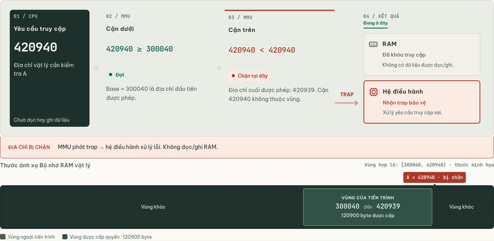

# Memory Workbench — bản giao diện trên nhánh phụ

Nhánh `design/memory-workbench` nâng cấp cách trình bày của cả 5 demo, tập trung làm rõ truy cập bị chặn ở Demo 1. Bản gốc để đối chiếu: `e6c48bc`. Không thay đổi `main` hoặc cấu hình GitHub Pages.

## Kết quả

- Nền giấy ấm, header mực đậm, tab điều hướng liền nhau; giảm khung viền, bóng và các thẻ màu lặp lại.
- Xanh teal cho thao tác/dữ liệu, vàng đất cho bước dò xét, đỏ gạch cho truy cập bị chặn. RAM có bề mặt tối riêng, các con số và vùng đang xử lý nổi bật hơn.
- Giữ font Việt hóa cục bộ và hệ cỡ chữ đã có. Các demo dùng chung cách chia khoảng cách, điều khiển và phần giải thích bên dưới.
- Điện thoại dùng bố cục dọc; thanh điều khiển nằm trong trang để không che nội dung. Tab hỗ trợ bàn phím; sáng/tối và giảm chuyển động vẫn hoạt động.

## Demo 1: thấy rõ vì sao không được vào RAM

Mô hình có bốn vị trí cố định: CPU, cận dưới, cận trên/bộ cộng, kết quả. Kết quả tách riêng cổng **RAM** và **hệ điều hành**.

Với `Base = 300040`, `Limit = 120900`, vùng hợp lệ là `[300040, 420940)`:

| Địa chỉ | Điều nhìn thấy |
|---|---|
| 300040 hoặc 420939 | Đạt hai cận; bước cuối mới mở đường vào RAM |
| 256000 | Cận dưới chặn; cận trên ghi “Bỏ qua”; bước cuối phát trap sang hệ điều hành |
| 420940 | Đạt cận dưới nhưng trượt cận trên; byte cuối được phép là 420939; RAM khóa |

Trong chế độ dịch địa chỉ, độ lệch phải thỏa `0 ≤ L < Limit`. Địa chỉ vật lý chưa xuất hiện trước bước cộng Base; độ lệch sai không tạo PA hoặc con trỏ RAM.

Màu đánh dấu theo trạng thái đã thực hiện. Việc quan sát điều kiện thất bại và việc hệ điều hành nhận trap là hai thời điểm khác nhau; đường trap chỉ bật ở bước cuối. Thanh bước cũng ghi “Bỏ qua cận trên” hoặc “Bỏ qua cộng Base”, không đánh dấu như một phép kiểm tra đã đạt.

Thanh RAM là **thước minh họa**: vùng được cấp được giữ đủ rộng để đọc số. Các ranh giới và công thức dùng đúng giá trị; chiều rộng không đại diện chính xác cho tỷ lệ byte.

## Ảnh kiểm tra

Ảnh desktop cùng kích thước 1366px, chụp từ trình duyệt bằng tài nguyên cục bộ. Ảnh trước lấy từ bản lưu `git archive e6c48bc`.

| Trạng thái | Ảnh |
|---|---|
| Demo 1 trước | [Bản gốc](review/workbench/demo1-before.png) |
| Demo 1 hợp lệ | [Giao diện mới](review/workbench/demo-b.png) |
| Demo 1 sai cận dưới | [RAM khóa, trap sang OS](review/workbench/demo1-denied-lower.png) |
| Demo 1 sai cận trên | [Chạm cận bị loại](review/workbench/demo1-denied-upper.png) |
| Demo 1 trên điện thoại | [390px](review/workbench/demo1-mobile.png) |
| Demo 1 nền tối | [Truy cập bị chặn](review/workbench/demo1-dark-denied.png) |
| Demo 2 | [Cấp phát](review/workbench/demo-a.png) |
| Demo 3 | [Phân trang & TLB](review/workbench/demo-x.png) · [Nền tối](review/workbench/demo3-dark.png) |
| Demo 4 | [Bộ nhớ ảo](review/workbench/demo-v.png) |
| Demo 5 | [Thay thế trang](review/workbench/demo-r.png) |



## Phạm vi kỹ thuật

`studio.css` cung cấp hệ giao diện chung; `studio-base.css` và `studio-base.js` dựng mô hình Demo 1 từ snapshot. Hai hook hiển thị trong `teaching.js` thay dây nối cũ bằng đường RAM/OS riêng. `lab-interface.js` bổ sung nhãn cho bước bị bỏ qua. Không sửa bộ dựng sự kiện, công thức, lựa chọn trang/khung, thứ tự dò xét, số bước hay thuật toán.

Mỗi bước vẫn là thao tác giảng dạy; không phải một chu kỳ CPU. Cách gộp/tách thao tác ở các demo được giữ như phạm vi mô phỏng trong README.

Kiểm thử điều hướng được cập nhật để kiểm tra 5 tên demo và tab hiện hành nổi bật. Yêu cầu cũ “mỗi tab một màu khác nhau” được thay bằng hệ điều hướng dùng chung; các kiểm tra snapshot và bàn phím giữ nguyên.

## Xác nhận

- `seeded-algorithms.cjs`: 320 trace, 6400 trạng thái, 240 lần tiếp tục qua mô hình đối chứng độc lập.
- `regression.cjs`: 11 nhóm đạt.
- `custom-problems.cjs`: 13 nhóm đạt.
- `teaching-flow.cjs`: 9 nhóm đạt.
- `scenes-browser.cjs`: 8 nhóm đạt.
- `academic-lab.cjs`: 9 nhóm đạt, kèm axe-core 4.10.3 sáng/tối trên 5 demo.
- `studio-browser.cjs`: 9 nhóm đạt khi bật axe; gồm cận dưới/cận trên, thời điểm PA xuất hiện, không có dây nối cũ đi vào RAM, giải thích còn nguyên, khôi phục snapshot, và các độ rộng 375/390/768/820/850/1024/1366/1920px.
- 20 lần quét axe trên toàn trang ở các trạng thái được ghi trong JSON: không có vi phạm tự động phát hiện theo WCAG A/AA đã chọn. Đã xem trực tiếp ảnh và kiểm tra tab bằng bàn phím; tự động hóa không thay thế toàn bộ đánh giá khả năng truy cập.
- Trình duyệt không báo lỗi JavaScript hoặc thiếu tài nguyên. Kiểm tra biên bổ sung: 25 đầu vào, 100 bước ở 375px, gồm Base 0 và giá trị lớn nhất hỗ trợ.

Kết quả máy đọc: [Studio](review/workbench/studio-results.json) · [Giao diện và accessibility](review/workbench/accessibility-results.json).

Chạy máy chủ tĩnh cổng 8080 như README, sau đó:

```sh
node tests/seeded-algorithms.cjs
node tests/regression.cjs
node tests/custom-problems.cjs
node tests/teaching-flow.cjs
node tests/scenes-browser.cjs
MEMORY_AXE_PATH=/path/to/axe.min.js node tests/academic-lab.cjs
MEMORY_AXE_PATH=/path/to/axe.min.js node tests/studio-browser.cjs
```

Không cần axe để chạy luồng và kiểm tra bố cục. Biến `MEMORY_AXE_PATH` bật thêm quét accessibility; website không tải axe, Playwright hoặc thư viện ngoài lúc sử dụng.
